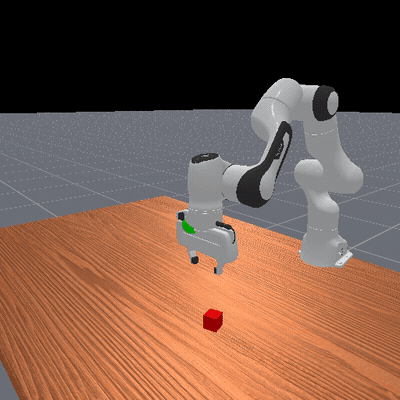
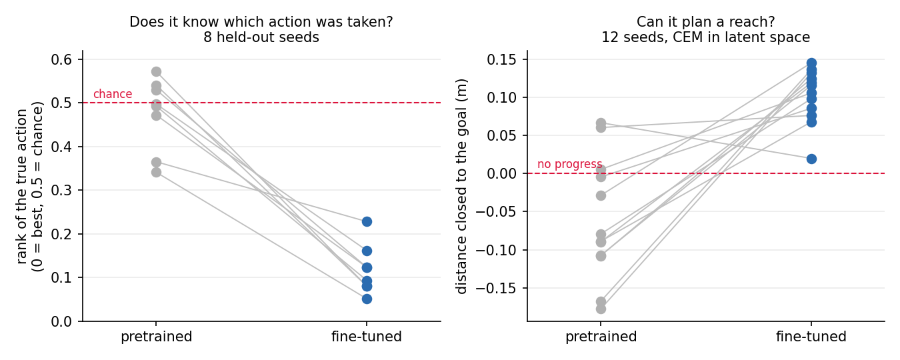

# V-JEPA 2-AC + ManiSkill

Using Meta's action-conditioned video world model to plan robot manipulation in
simulation, on a laptop GPU.



I wanted to see whether V-JEPA 2-AC, which Meta trained on real robot video,
works as a planner inside a simulator on my laptop (RTX 3060, 6 GB). There is no
policy network anywhere in this project. Actions come from searching over
imagined futures with CEM.

## Results

| task | method | result |
|---|---|---|
| Reaching | world model plans in latent space | closes ~2/3 of the distance on **12/12 seeds**, p=0.0003 |
| Grasping | encoder as a position sensor, analytic dynamics | **96.7% grasp, 100% PickCube** over 30 seeds |
| Grasping | same, with the predictor in the loop | 100% grasp, 83.3% PickCube (6 seeds) |
| New objects | same pipeline, 16 unseen YCB objects | **0%**, the position decoder is cube-specific |

Four things I found:

The pretrained model does not transfer to simulation. Zero-shot on ManiSkill
renders it cannot tell which action was taken, sitting at chance. Fine-tuning
just the predictor (the encoder stays frozen) on 4,000 simulator frames moves the
true action from the 48th percentile of candidates to the 12th, and that is what
makes planning work.

Reaching works using the world model. The fine-tuned model imagines each
candidate action, compares the result to a goal image, and picks the best. It
closes about two thirds of the distance on all 12 test seeds, while the
pretrained model actively moves away.

Grasping also works, but not because of the world model. When I removed the
predictor and replaced it with one line of arithmetic (commanding action `a`
moves you by `a`), it did slightly better: 100% success instead of 83.3%. So the
grasping result comes from the encoder being a good position sensor, not from the
predictor being a good dynamics model. Decoding a position out of an imagined
latent carries 2.33 cm of error against 1.11 cm for a real one, and moving
through free space needs no prediction anyway.

It does not generalise to new objects. Running the identical pipeline on 16
YCB objects gives 0% and a 27 cm miss, because the position decoder was trained
to find a red cube and nothing else.



The [detailed results](RESULTS.md) have all 16 experiments, including the wrist
camera comparison, the nine planner configurations that failed, and the language
instruction work.

## ManiSkill vs V-JEPA state format

This cost me most of a day, so it is worth writing down. ManiSkill's
`extra/tcp_pose` and V-JEPA 2-AC's `states` are both 7-dimensional, so they
concatenate without any error and mean completely different things:

| | layout |
|---|---|
| ManiSkill `tcp_pose` | `[x, y, z, qw, qx, qy, qz]`, a quaternion |
| V-JEPA 2-AC `states` | `[x, y, z, roll, pitch, yaw, closedness]`, euler plus gripper |

Actions have a second, separate mismatch. ManiSkill's `pd_ee_delta_pose` emits
values in `[-1, 1]` that the controller scales to 0.1 m, while the predictor
wants metric deltas and was trained on DROID at roughly 0.05 m or less. Feeding
raw ManiSkill actions overstates every motion by about 10x at full scale.

Both conversions live in `vjepa/core/adapter.py` and nowhere else, checked
against `vjepa2_src/notebooks/franka_example_traj.npz`.

## Install

```bash
pip install torch torchvision mani-skill transformers huggingface_hub timm einops scipy
sudo apt install libvulkan1 libegl1 libgl1-mesa-dri   # headless rendering
./setup.sh    # clones facebookresearch/vjepa2 into vjepa2_src/
```

Weights are pulled from Hugging Face on first use (5.27 GB) and cached in
`~/.cache/huggingface`.

`torch.hub` does not work for this model. `src/hub/backbones.py` ships a debug
value, `VJEPA_BASE_URL = "http://localhost:8300"`, so nothing downloads, and the
real checkpoint is 11.76 GB because it carries optimizer state. `vjepa/core/loader.py`
builds the model from the vendored source and loads the stripped 5.27 GB
inference checkpoint from the `facebook/jepa-wms` mirror instead.

Not committed here: the cached latents (2.9 GB), the fine-tuned weights (294 MB)
and the recorded trajectories. Everything needed to rebuild them is in the repo,
and the small `.npz` result files are committed so every number above can be
checked without rerunning anything.

## Run

Everything runs as a module from the repository root.

```bash
python3 -m vjepa.evaluate.visualize --seed 0      # watch it solve PickCube
python3 -m vjepa.plan.hier_plan --seeds 30        # the grasping planner
python3 -m vjepa.plan.hier_plan --ablate-predictor --seeds 30   # without the world model
python3 -m vjepa.evaluate.eval_planning           # reaching, pretrained vs fine-tuned
python3 -m vjepa.evaluate.language_plan --demo    # language instructions
```

To rebuild from scratch:

```bash
python3 -m vjepa.diagnose.validate_reference   # does the stack work at all?
python3 -m vjepa.data.collect_data             # cache 4k encoded frames, ~25 min
python3 -m vjepa.train.finetune --epochs 4     # fine-tune the predictor, ~30 min
python3 -m vjepa.train.fit_keypoint --near     # position decoder
python3 -m vjepa.evaluate.eval_finetuned       # fresh-seed paired test
```

Run `validate_reference.py` first. It works entirely on Meta's own ground-truth
Franka pair, so it separates "is the model wired up correctly" from "does it
transfer". If it fails, nothing downstream means anything.

## Layout

```
vjepa/
├── core/        loader, adapter, record
│                  model loading, ManiSkill <-> DROID conversions, the simulator
├── data/        collect_data, collect_grasp_data
│                  roll episodes and cache encoder latents to disk
├── train/       finetune, fit_decoders, fit_keypoint
├── plan/        cem_plan, state_planner, subgoal_plan, plan_grasp, dual_plan,
│                grasp_cost, hier_plan
│                  newest last; hier_plan is the one that works
├── diagnose/    13 scripts, each answering one yes/no question
└── evaluate/    eval_finetuned, eval_planning, eval_grasp, eval_objects,
                 language_plan, language_goal, visualize

checkpoints/   trained weights (.pt gitignored, small .npz probes kept)
results/       every experiment's measurements as .npz
media/         rendered frames, plots and grasp.mp4
```

## What I would try next

- Train with a multi-step rollout loss instead of the one-step latent objective.
  Result 9 shows the 0.19 prediction error floor is not a capacity or data-volume
  limit, so the objective is the suspect.
- Collect on-policy data from the planner itself rather than random and scripted
  rollouts, for the same reason.
- Swap the cube-specific position decoder for an object detector, which is the
  direct fix for the 0% YCB result.
- Try the simulation-trained checkpoints. `facebook/jepa-wms` also has
  `jepa_wm_metaworld.pth.tar` (0.21 GB) and `dino_wm_metaworld.pth.tar`
  (0.28 GB), which are small and test the real-to-sim gap directly.

## Notes from doing this

- Disk space was a bigger problem than GPU memory. The checkpoint is 5.27 GB and
  my laptop had about 2 GB free after downloading it.
- Weights load in fp16 and use 2.65 GB of VRAM. Peak across all of these
  experiments was 2.68 GB, so the 6 GB card was never the limit.
- The thing that surprised me most was the ablation in result 14. I had already
  measured every number needed to predict that removing the predictor would help,
  three experiments before I actually ran the control.
- The bug that cost me the most time was in the carry phase, not the model. The
  cube hangs about 2.4 cm below the tool point, so I was servoing the gripper when
  I should have been servoing the cube, and every earlier success had been
  passing by roughly a millimetre.
- Several of my diagnostic scripts print a pass or fail verdict whose threshold
  turned out to be wrong for the case at hand. `servo_check.py` printed "cannot
  close the gap" while grasping 6 out of 6. Read the numbers, not the verdict.
- Two things about the model that will waste your time: its RoPE builds angles in
  fp32 while the values stay fp16, which makes `scaled_dot_product_attention`
  reject the mismatch (every forward runs under `torch.autocast` because of this),
  and building the encoder on the meta device fails because
  `VisionTransformer.__init__` calls `.item()`.
- If you hit OOM in CEM, lower `--chunk` first. It does not change the results.
